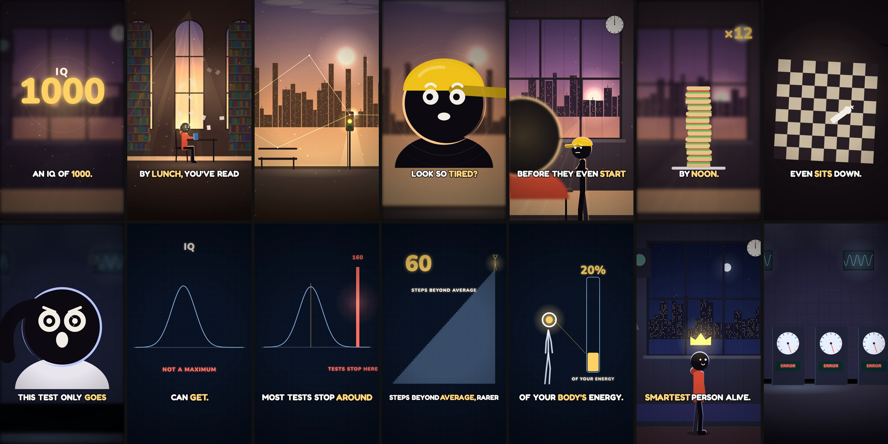

# cinestick

**Cinematic stick-figure story videos where the characters talk to each other, made entirely in code by Claude Code.**

Give it a title, an idea or a full script. Cinestick writes the story, voices every character offline, directs the shots,
draws every frame, scores it, and hands you an MP4, in **9:16 or 16:9**, **short or long**.

```
/cinestick:make-video "What if you had 1000 IQ"
```



## What it makes
- **One look:**
  - black stick figures with rim light and one signature colour each;
  - moody, lit sets with dust, glows and god rays;
  - giant face close-ups;
  - freeze-frames;
  - blueprint diagrams;
  - data counters;
  - the occasional 3D fly-through;
  - a cinematic grade (`dusk`);
  - gold-word captions.
- **Characters who talk:**
  - a narrator (the hero telling their own story, or an off-screen voice) plus 1–4 characters;
  - creatures included (germs, cells, critters);
  - lip-synced to the real word timings.
- **Directed like the story shorts it learned from:**
  - a new shot every 1–2 s, cut on the stressed word, with soft dissolves;
  - a camera that always moves;
  - faces that change mid-line;
  - literal gags;
  - a callback ending.
- **Formats:** Shorts (~45–75 s, seven story beats) and long videos (up to ~10 min, chapters), at 720p–4K.
- **Costs:** no paid APIs, no image/video AI, no stock footage. Voices run offline (Kokoro). Everything is drawn by HTML canvas + Three.js and rendered by headless Chromium + ffmpeg.

## Install
You need **Claude Code**, **Node.js ≥ 18**, **ffmpeg**, and **Python 3.11–3.13**. kokoro-onnx doesn't support Python 3.14 yet; setup finds a compatible Python for you.

| | macOS | Ubuntu/Debian (and Windows via **WSL**) |
|---|---|---|
| Node ≥ 18 | `brew install node` | the distro's `nodejs` is too old on 22.04: use [NodeSource](https://github.com/nodesource/distributions) (`curl -fsSL https://deb.nodesource.com/setup_20.x \| sudo -E bash - && sudo apt install -y nodejs`) |
| ffmpeg | `brew install ffmpeg` | `sudo apt install -y ffmpeg` |
| Python 3.12 | `brew install python@3.12` | 24.04: `sudo apt install python3.12 python3.12-venv`; 22.04: add the [deadsnakes](https://launchpad.net/~deadsnakes/+archive/ubuntu/ppa) PPA first (`sudo add-apt-repository ppa:deadsnakes/ppa`) |

**Windows:** run Claude Code inside **WSL** (Ubuntu) and follow the Linux column; the setup script is POSIX `sh`.
On Linux, setup installs Chromium with `npx playwright install --with-deps chromium` (the system libraries headless Chromium needs; it asks for sudo).

Cinestick can be installed **side by side** with the aiTrends 2D Studio plugin: its commands are all `/cinestick:*` and its studio folder is `cinestick-studio/`.

Then in Claude Code:
```
/plugin marketplace add fadhiljr7/cinestick
/plugin install cinestick@cinestick
```

The first `/cinestick:make-video` copies the studio into your workspace (`./cinestick-studio/`) and runs `sh tools/setup.sh`. You can also run it yourself. It:
1. creates `.venv` and installs the Python libraries:
   - `numpy`, `scipy`, `soundfile`, `soxr`: audio;
   - `faster-whisper` and `av<19`: the speech check and word timings;
   - `kokoro-onnx`: the voices;
2. runs `npm install` for `three`, `playwright` and the fonts, then `npx playwright install chromium`;
3. downloads the Kokoro voice model (`kokoro-v1.0.onnx` + `voices-v1.0.bin`, ~350 MB, once);
4. runs `tools/doctor.py` and renders a self-test contact sheet.

Whisper downloads its `base.en` model (~145 MB) the first time it checks a voice.

## Use
```
/cinestick:make-video "What if you had 1000 IQ"                 → 9:16 Short (the default)
/cinestick:make-video "The history of the lighthouse" 16:9 long
/cinestick:make-video <paste your own script>
```
1. **The one question.** Cinestick shows the plan and waits for your OK:
   - for a Short: format, narrator mode and voice, the cast with signature colours, and the **seven beats** (Hook, Setup, Doubter, Escalation, Turn, Reveal, Closing line);
   - for a long video: a cold open, the chapters and an outro.

   Change anything and it re-pitches. If you wrote some lines yourself, they're kept word for word.
2. **Everything else runs on its own**: voices → shots → scenes (it checks its own contact sheets) → render → music & SFX → MP4. You get the contact sheet on the way and the MP4 at the end.
3. **Files:** `cinestick-studio/projects/<slug>/out/<Title>.mp4` (+ `.srt`).

Re-run single steps when you want changes:
- `/cinestick:story`: new beats or cast;
- `/cinestick:voices`: change a voice or line; only changed lines are re-made;
- `/cinestick:render`: sheets, previews, re-render;
- `/cinestick:sound`: music mood, SFX, your own music.

## How it works
```
title / idea / script
  └─ story: 7 beats (Short) or chapters (long) + narrator mode + cast  ──►  YOUR OK
       └─ input/lines.json  (narration + dialogue, one voice per character)
            └─ tools/voice/voices.py   Kokoro → pitch/tempo treatment → Whisper check → retry → cache
                 └─ assemble.py        voiceover.wav + words.json (word times + who said it) + dialogue.js
                      └─ story/shots.json  (cut on stressed words; types; transitions; music plan)
                           └─ tools/plan_check.py   the directing rulebook (pace, variety, callback…)
                                └─ scenes/*.js      sets, cast, creatures, shots, drawn in code
                                     └─ render.mjs  headless Chromium, frame by frame → video_silent.mp4
                                          └─ audio/mix.py   music + SFX + ambience + voice → −14 LUFS → MP4
```

## How the voice-over is made
- **Engine:** [Kokoro-82M](https://huggingface.co/hexgrad/Kokoro-82M) through `kokoro-onnx`, fully offline, with English voices (`af_*`, `am_*`, `bf_*`, `bm_*`).
- **Voices:**
  - the woman narrator defaults to `af_heart`, the man to `am_michael`;
  - each character gets their own voice;
  - a **treatment** shapes the role: `normal` is ×1.1 tempo for a lively story pace; `side` is slightly lower; `creature` is pitched up ×1.3; `villain` is pitched down ×0.82 with echo and extra bass.
- **Speech check:** every line is transcribed back with **faster-whisper** and compared with the script. A misheard line is made again up to twice, each slightly slower; if it still fails it's flagged for you. Numbers are understood ("1000" ↔ "a thousand").
- **Timing:**
  - the lines are laid end to end with natural gaps: a quick 0.14 s between sentences, 0.22 s before a reply, and a held 0.4 s breath before the turn and before "You see…";
  - Whisper's word timestamps drive the cuts, the lip-sync and the captions;
  - each word knows who said it, so a caption never mixes two speakers.
- **Re-runs:** an unchanged line is never re-made (`voices/cache.json`).

## How the music is made
`audio/music.py` composes the score in code, with no samples and no internet:
- **Plan:** the film is split into **mood sections**: `mystery, tension, action, wonder, hopeful, sad, triumph, playful, calm, dark, epic`, each with an intensity from 0 to 1. A Short typically runs tension (hook) → playful (setup) → action (escalation) → dark (turn) → mystery (reveal) → dark or triumph (closing).
- **Layers:** each section gets a chord progression in its mood's key and tempo, then synthesised layers (pads, plucked arpeggios, a piano-like voice, bass), with drums that come in as the intensity rises.
- **Transitions:** sections crossfade. The one before the reveal can **stop dead** (`"cut": true`) for the silent beat before "You see…".
- **Your own track:** set `music.file` in `config.json`.

## How the sound effects are made
`audio/sfx.py` synthesises every cue from noise, oscillators and envelopes:
- **Library:** `whoosh, swish, impact, hit, riser, slowmo, freeze, tick, clock, heartbeat, pop, blip, counter, ding, shimmer, stinger, footstep, kick, whistle, carpass, phonebuzz, phonering, cheer, applause, murmur, glitch, flash, buzz, powerup`.
- **Ambience beds:** `rain, wind, city, roomtone, murmur, hum`.
- **Placement:** cues are placed per shot by the directing rules. `whoosh` goes on whips, `pop` on face snaps and graphics, `impact` on hits, a `riser` into the turn and a `stinger` on the closing word. Ambience runs under every scene for a continuous world.

## The mix
`audio/mix.py`:
1. lays the voice in the centre;
2. **ducks the music −9 dB and the ambience −5 dB** whenever someone speaks;
3. adds the SFX;
4. normalises the master to **−14 LUFS** (YouTube/Shorts loudness);
5. muxes the MP4.

## Directing rules
Learned by studying ten reference story shorts frame by frame. The full rulebook is in `plugin/skills/make-video/references/directing.md`, and `tools/plan_check.py` enforces the numbers.
- **Shorts:** median shot ≤ 2 s (target 1.5 s), none over 3.5 s except the closing hold. Cut on the stressed word, with a cross-dissolve by default. Flash or whip only on the turn. At most 2 freeze-frames. The last shot is a **callback** to an earlier framing, changed.
- **Long videos:** a 2–4 s median, and each chapter opens with an establishing shot after a dip to black.
- **Camera:** one move per shot: push-in on the speaker, pan following action, dolly past a prop, pull-back reveal, dutch tilt for unease, top-down for tables and maps.
- **Acting:** in a held close-up the face changes 2–4 times as the line plays. Listeners react. The doubter is always a face. Quoted lines are acted out literally.
- **Shot vocabulary:** establishing, two-shot, over-the-shoulder, giant face, insert, POV screen, circle mask, meanwhile, time-skip, fact-on-an-object, blueprint, data, 3D, freeze, callback. The same type never runs more than twice in a row.

## Troubleshooting
- **`kokoro-onnx` won't install / Python 3.14:** install `python@3.12` (see the table above), delete `cinestick-studio/.venv`, then re-run `sh tools/setup.sh`.
- **Chromium download stuck:** `export PW_CHROMIUM=/path/to/chrome-headless-shell` (any recent Chromium) and re-run. `render.mjs` and `doctor.py` honour it.
- **A voice line keeps failing the check:** reword it, or add `"asr": "<how Whisper spells it>"` to that line in `input/lines.json`, then re-run `/cinestick:voices`.
- **Whisper can't download its model:** set `HF_ENDPOINT` to a Hugging Face mirror.
- **Slow renders:** they run on the CPU at about 10–15 frames/s at 1080p on an M-series Mac. A 60 s Short takes ~3 min, and long videos render chapter by chapter, resumable (`tools/render_long.py`).
- **Black 3D shot:** add `--gl swiftshader` to the render command.

## Credits & licenses
- **cinestick:** MIT © 2026 Muhammad Fadhil Abidin (fadhiljr7), except the third-party files below.
- **aiTrends 2D Studio:** the rendering engine, rig, effects, music/SFX generator and mixer in `plugin/kit/`, plus four adapted reference docs. Not covered by this repo's MIT license; included as-is with small changes and removed on the author's request. See [`plugin/kit/NOTICE`](plugin/kit/NOTICE).
- **lemo-opuscar** (MIT, © LemoLab): `tools/voice/tts.py` and `asr_check.py`.
- **Kokoro-82M** (Apache-2.0) via **kokoro-onnx** (MIT); **faster-whisper** (MIT) with OpenAI Whisper models (MIT); **three.js** (MIT); **Playwright** (Apache-2.0); fonts via **@fontsource** (OFL).

See [CREDITS.md](CREDITS.md).
